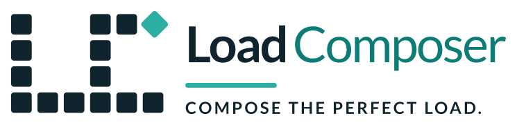
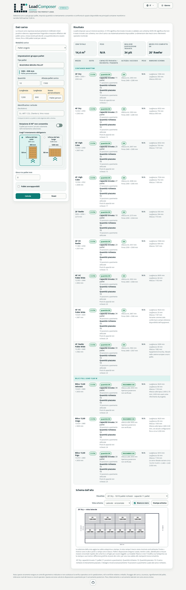
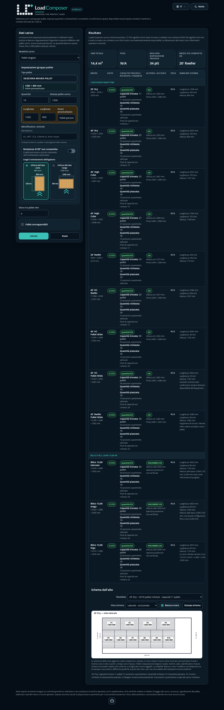
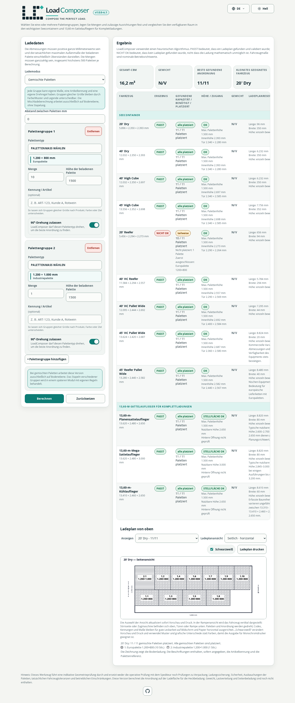
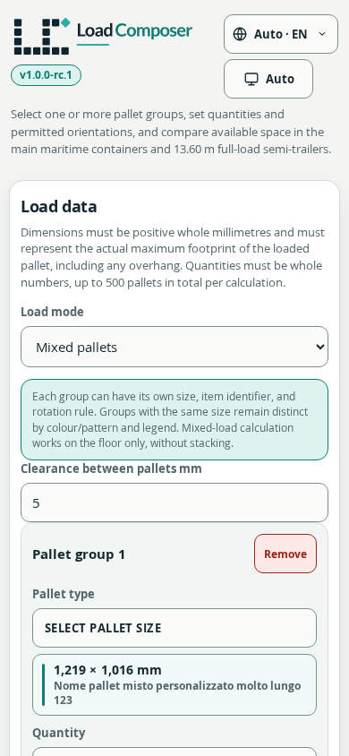

<p align="center">
  
</p>

<p align="center"><strong>Compose the perfect load.</strong></p>

# LoadComposer

LoadComposer è un ausilio alla pianificazione nel browser che stima la disposizione geometrica dei pallet nei principali container marittimi e bilici da 13,60 m. Gestisce carichi a pallet singolo e misti, rotazione e orientamento obbligatorio dell’inforcamento, quantità su livelli, anteprime responsive, stampa operativa localizzata e una pagina standalone offline.

> **Versione corrente:** `v1.1.0` (prima versione stabile: `v1.0.0`). Verificare sempre i risultati prima dell’uso operativo.

| Giorno | Notte |
|---|---|
|  |  |

| Pallet misti desktop | Pallet misti mobile |
|---|---|
|  |  |

## Funzioni

- Composizione con un tipo di pallet o pallet misti, quantità a pavimento e su livelli.
- Formati predefiniti, misure personalizzate e vincoli di orientamento.
- Container 20' Dry, 40' Dry, 40' HC, 45' HC, 20' Reefer, 40' HC Reefer, 40' e 45' HC Pallet Wide e 45' Reefer Pallet Wide.
- Bilici da 13,60 m telonato, mega e frigo.
- Vista laterale e dalla rampa, colore e bianco/nero, tema chiaro e scuro.
- Interfaccia e stampa in italiano, inglese, tedesco, spagnolo, francese, portoghese e olandese.
- Deploy web modulare con cataloghi locali e pagina HTML standalone autonoma per `file://`.
- Elaborazione locale nel browser senza backend applicativo, tracker, analytics, font esterni o dipendenze CDN a runtime.

## Avvio rapido

```bash
python3 -m http.server 8000 --directory site
```

Aprire `http://127.0.0.1:8000/`. Per l’uso offline il download principale è:

```text
site/downloads/loadcomposer-v1.1.0-standalone.zip
```

Estrarre il pacchetto, verificare `SHA256SUMS.txt` e aprire l’HTML incluso.
Il download secondario **Solo HTML standalone** resta disponibile come
`site/downloads/loadcomposer-v1.1.0-standalone.html`.

Per ricostruire e verificare:

```bash
node --version  # v22.17.0 oppure una versione compatibile >=24.0.0
npm ci
npm test
```

La baseline verificata è Node.js 22.17.0 con npm 11.9.0. Su Cloudflare Pages
non servono framework o comando di build: la directory di output è `site`.
Seguire [GITHUB_FIRST_PUSH.md](docs/GITHUB_FIRST_PUSH.md),
[DEPLOYMENT.md](docs/DEPLOYMENT.md) e
[CLOUDFLARE_PREVIEW_CHECKLIST.md](docs/CLOUDFLARE_PREVIEW_CHECKLIST.md).

## Limiti essenziali

LoadComposer produce stime geometriche mediante disposizioni euristiche. Non è un’analisi ingegneristica, un’istruzione di carico, una certificazione di sicurezza o un controllo normativo. Non determina conformità di peso, distribuzione, baricentro, assi, pavimento, stabilità, rizzaggio, imballaggio, accesso dei mezzi di movimentazione, merci pericolose o tolleranze reali. “NON OK” non dimostra che una disposizione sia impossibile; un esito positivo non dimostra sicurezza o legalità.

Confermare misure ed equipment e richiedere verifiche qualificate operative, ingegneristiche, di sicurezza, del vettore e legali. Leggere [LIMITATIONS.md](docs/LIMITATIONS.md) e [LICENSE](LICENSE).

## Licenza e progetto

LoadComposer è source-available con la licenza personalizzata [LoadComposer Community License 1.0](LICENSE), `LCCL-1.0`, espressa nei metadati come `LicenseRef-LoadComposer-Community-1.0`. Consente gli usi descritti, incluso il normale uso interno d’impresa, e riserva alla licenza commerciale gli sfruttamenti monetizzati definiti. Fa fede il testo inglese; [LICENSE.it.md](LICENSE.it.md) è una traduzione informativa.

- [Indice legale pubblico](site/legal/)
- [Licenza commerciale](COMMERCIAL-LICENSING.md)
- [Contributi](CONTRIBUTING.md) e [CLA](CLA.md)
- [Sicurezza](SECURITY.md)
- [Privacy](PRIVACY.md)
- [Marchi](TRADEMARKS.md)
- [Roadmap](ROADMAP.md)

Sito ufficiale: [loadcomposer.com](https://loadcomposer.com/)  
Repository ufficiale: [github.com/LoadComposer/loadcomposer](https://github.com/LoadComposer/loadcomposer)

Copyright © 2026 Marco Pernigotti.
